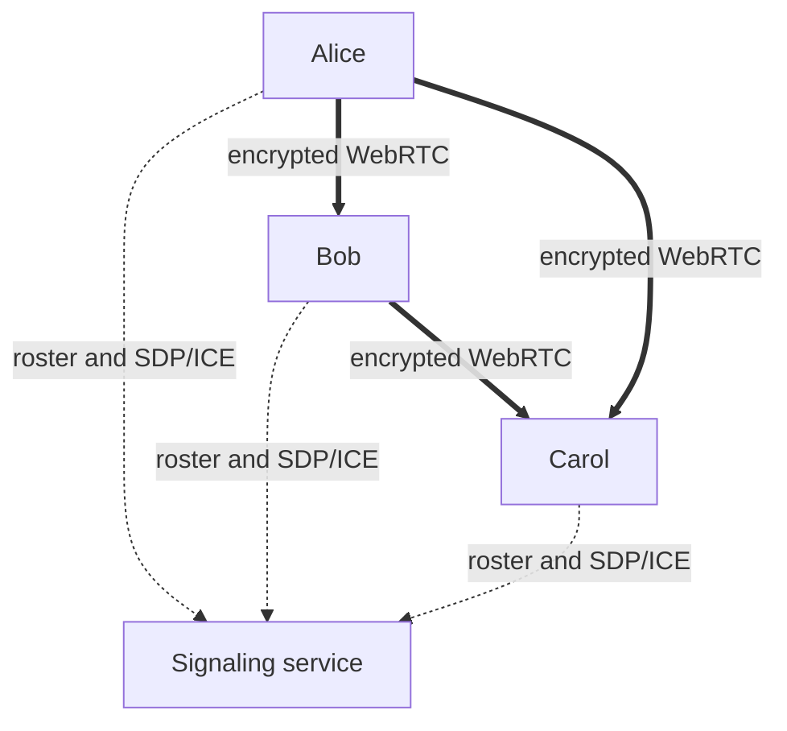

A fixed-size encrypted chunk is not invisible. It is only one less thing an observer can sort by.

That distinction has driven p2party since the first browser mesh started moving encrypted bytes in 2024. We wanted a watcher to pay for every guess. Give the watcher ciphertexts of one shape, hide useful bytes at random offsets, mix in authenticated junk, and force the watcher to keep more material than the conversation deserved. That is the "offensive" in offensive cryptography: confidentiality is the floor, not the whole fight.

The road from that idea to protocol-v3 was mostly a record of learning exactly where the idea stopped.

## The first mesh had encryption, but not a protocol

The repository began at commit [`72457f9`](https://github.com/p2party/p2party-js/commit/72457f9) on 12 September 2024. AEAD and Ed25519 arrived in [`bc7f282`](https://github.com/p2party/p2party-js/commit/bc7f282) the following month. By December, every logical message had its own ephemeral WebRTC DataChannel in [`d59517b`](https://github.com/p2party/p2party-js/commit/d59517b).

That last choice looked like transport plumbing. It turned out to be product architecture.

A message-scoped channel gives one transfer its own send buffer, progress, cancellation, retry boundary, and teardown. A large file can stall without blocking a short text message. Cancel means closing one logical operation, not teaching a permanent multiplexed connection how to unwind half a protocol. We kept that model all the way into v3.

The data plane was already a mesh. The signaling server introduced room members, but it did not sit in the middle of normal room traffic. With `n` members, each endpoint opened `n-1` WebRTC peer connections and the room formed `n(n-1)/2` pairwise edges.



Calling that architecture a "star" without qualification is misleading. The control plane was a centralized star. The message data plane was, and remains, a full peer mesh.

## Uniform chunks moved the leak instead of deleting it

The early transport split each message into roughly 64 KiB chunks. Real content sat at a randomized offset inside a noise-filled plaintext, then AEAD protected the result. Decoy chunks used metadata that caused a legitimate recipient to decrypt and discard them. A peer without the message key, or a passive observer outside DTLS, should not be able to sort real from decoy by looking at the application payload.

The mechanism was useful, but the threat model needed surgery.

Uniform application writes hide application-level length differences inside an active transfer. They do not hide:

- that a DataChannel opened;
- when chunks were sent;
- how SCTP fragmented, retransmitted, or reset a stream;
- whether a direct connection or TURN relay existed;
- who joined a room;
- whether the browser went to sleep;
- or the fact that no traffic was sent while everybody was idle.

RFC 8831 puts DataChannels over SCTP, DTLS, and ICE. Equal buffers at the JavaScript boundary do not automatically become indistinguishable packet traces. That is an experiment, not a property we get to declare.

Current protocol-v3 cells are exactly 65,490 bytes, not the old shorthand "64 KiB." The difference matters because the frame budget now includes a typed ratchet header, random nonce, encrypted metadata, payload, and padding. Precision is cheap. We should use it.

## Four bugs dismantled the comfortable story

The July 2026 hardening pass treated the transport as hostile code rather than inherited truth. It found problems that all lived below the pretty diagram.

### The decoy sampler overflowed

`randomNumberInRange` accumulated bytes with signed 32-bit shifts even though the decoy range approached JavaScript's 53-bit integer limit. The overflow could generate a decoy offset inside the valid real-data range, corrupting reassembly, or produce a negative value and abort a send.

Commit [`8340686`](https://github.com/p2party/p2party-js/commit/8340686) replaced it with unbiased BigInt rejection sampling. The bug is a useful warning: "cryptographically random" is meaningless if the integer mapping after the RNG is wrong.

### The sender leaked its own WASM heap

Two buffers allocated for every send were never freed. One hundred and twenty-eight bytes per send does not sound dramatic until the heap is fixed and the application stays open. Then it is a delayed self-denial-of-service.

The fix in [`656d6dd`](https://github.com/p2party/p2party-js/commit/656d6dd) removed dead allocations, and [`ffef0e1`](https://github.com/p2party/p2party-js/commit/ffef0e1) made secret frees wipe memory first. A correct ciphertext does not prove the key material disappeared after use.

### A signature became a cross-protocol oracle

In January 2025, [`ad494b5`](https://github.com/p2party/p2party-js/commit/ad494b5) authenticated each chunk with a signed ephemeral key. The same Ed25519 identity also signed a server login challenge of the same length.

A malicious signaling server could choose a challenge equal to an attacker's ephemeral public key, collect the victim's legitimate signature, and replay it as chunk authentication. No signature forgery was required. The protocol had asked the same key to sign two syntactically identical statements with different meanings.

Commit [`0174333`](https://github.com/p2party/p2party-js/commit/0174333) bound chunk authentication to a domain-separated transcript:

```text
"p2party-chunk-auth-v1" || MerkleRoot || ephemeralPublicKey
```

The signature primitive was fine. The protocol sentence being signed was not.

### Receipts betrayed the decoys

The receiver originally acknowledged only accepted real chunks. Forward traffic could be full of convincing noise, but reverse traffic counted the useful frames for the observer.

Commit [`6016862`](https://github.com/p2party/p2party-js/commit/6016862) made the receiver emit one true-or-random token for every forward frame. Protocol-v3 now carries that token in an exact 65-byte typed receipt frame. A decoy that does not produce the same observable acknowledgement pattern is not cover. It is a label.

## Merkle trees also have protocol semantics

The transfer Merkle tree originally used the same hash operation for leaves and internal nodes, and self-hashed an odd final node. That admits the CVE-2012-2459 class of structural ambiguity where different leaf structures can arrive at the same root.

Commit [`c39c4d6`](https://github.com/p2party/p2party-js/commit/c39c4d6) made the grammar explicit:

```text
leaf     = SHA-512(0x00 || chunk)
internal = SHA-512(0x01 || left || right)
odd      = promote unchanged
```

The root now commits not only to bytes, but to which bytes were leaves and which values were tree structure. This is not novel cryptography. It is the difference between using a hash function and defining a hash protocol.

## What this transport honestly provides

The current shipped mechanism earns a narrow claim:

- During a transfer, application frames have one fixed size.
- Real payload starts at a randomized encrypted offset.
- The remaining capacity is randomized padding.
- Full-noise decoy frames can occupy transfer slots.
- Merkle authentication detects missing or changed content.
- Every forward frame receives one same-shaped receipt.

That makes exact payload length and real-versus-decoy classification harder at the application-cell layer. It does not provide continuous timing cover, endpoint anonymity, room-membership privacy, or packet-trace indistinguishability.

Those missing properties are not footnotes. They became the research agenda.

## Try the mesh, then inspect the machinery

Open [p2party.com](https://p2party.com), create a room, and join it from another browser profile or device. Add a third member and watch the room behave as a peer mesh rather than a server-hosted group chat.

The implementation history is public in [`p2party-js`](https://github.com/p2party/p2party-js). The factual ledgers behind this series are the [protocol evolution log](https://github.com/p2party/p2party-js/blob/master/docs/protocol-evolution-decision-log.md) and [security findings](https://github.com/p2party/p2party-js/blob/master/docs/design-decisions-and-security-findings.md).

The next chapter starts with the most embarrassing kind of cryptographic bug: a nonce design that required the receiver to decrypt a value before it could decrypt the value.
