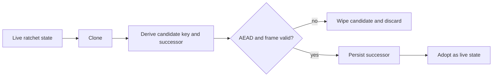

The first protocol-v3 chunk nonce was impossible. The receiver needed the chunk index to decrypt, but the chunk index was inside the ciphertext.

No amount of green round-trip testing could rescue that design because no round trip existed yet. The useful move was to attack the specification before the implementation made the mistake expensive.

That became the working method for protocol-v3: known-answer tests prove the primitive wrapper does what we think, and a separate adversarial pass asks whether we thought about the right property at all.

## The nonce that lived behind its own locked door

The original plan set the ChaCha20-Poly1305 nonce to `chunkIndex`. A deterministic index looks tidy until you draw the receive path:

```text
wire frame
  -> need nonce
  -> decrypt metadata
  -> learn chunkIndex
```

The cycle is fatal. The receiver needs the nonce before the operation that reveals it.

The tempting patches were worse:

- Reuse a message counter for every chunk under the same message key. That repeats a ChaCha20-Poly1305 nonce and breaks the AEAD security assumptions.
- Put the raw index in the clear. That exposes ordering and chunk count to the observer we were trying to frustrate.

Commit [`92b07e8`](https://github.com/p2party/p2party-js/commit/92b07e8) moved to a fresh random 12-byte nonce in the clear frame header. The nonce is not secret. It must be unique for the message key, available before decryption, and authenticated as part of the AEAD operation.

The current v4 frame starts with:

```text
type(1) || dhPub(32) || N(8) || PN(8) || pqEpoch(8) || nonce(12)
```

This gives a 69-byte clear header and puts encrypted content at byte 69. The first 57 bytes, everything except the nonce, are authenticated as associated data. If a chunk is resealed, it gets a fresh nonce. The invariant is simple: never repeat a `(message key, nonce)` pair.

The epoch field is eight bytes because v3's single byte was a latent bug: sparse post-quantum healing advances that counter for the life of a session, and a one-byte counter wraps. Widening it was part of why v4 is a wire break rather than an extension.

## Correct primitives can still compose into the wrong protocol

Protocol-v3 uses established parts: X25519, Ed25519, ML-KEM, CPace, HKDF-SHA512, ChaCha20-Poly1305, and a Double Ratchet. We did not invent any of them.

The dangerous work happens in the glue.

### Bare concatenation made the CPace transcript ambiguous

The first CPace generator input used:

```text
SHA-512(domain || PIN || sid || channelInput)
```

Without lengths, different field boundaries can encode the same byte string. Once `channelInput` carries variable-length application context, that is not a stylistic concern. It changes which protocol statements the PAKE binds.

Commits [`e5f6348`](https://github.com/p2party/p2party-js/commit/e5f6348) and [`58c02a4`](https://github.com/p2party/p2party-js/commit/58c02a4) adopted CPace's length-value concatenation and wiped PIN bytes left in WASM memory. Hash functions do not understand fields. Protocols have to teach them.

### A valid ratchet step could destroy a valid live session

The Double Ratchet primitive advances state while it derives a candidate message key. Authentication happens later, when the chunk AEAD is checked.

If production passed the live object directly, a replay or forged frame could advance state and then fail authentication, leaving the receiver desynchronized. A passing unit test for an honest message does not expose that boundary.

Production now treats ratchet advancement as speculative:



Only an authenticated, durably stored successor becomes live. This is a transaction boundary, not a tweak to the ratchet math.

### A DTLS MITM tripwire failed open when blind

The handshake binds the SDP-advertised DTLS fingerprints into its transcript, then reads the live certificate fingerprints from `RTCPeerConnection.getStats()` and compares them.

The first guard rejected a mismatch only when the live fingerprint was non-null:

```ts
if (liveRemoteFp !== null && liveRemoteFp !== remoteSdpFp) throw error;
```

When the certificate stat was absent, the tripwire passed precisely because it could not see. Commit [`2af322b`](https://github.com/p2party/p2party-js/commit/2af322b) changed "unverifiable" to the same outcome as "mismatch": abort.

This was rated critical in review. Honest-path tests supplied the expected certificate stat, so they never asked what happened when the browser report was incomplete.

## One identity key was doing too many jobs

Older p2party code converted one Ed25519 identity into X25519 material and used the same long-term root of trust for signing and DH. That is convenient and not known to be broken in this exact use, but it creates a cross-protocol assumption no standard gave us for free.

Protocol-v3 chose separate keys:

- Ed25519 remains the identity and signing anchor.
- A dedicated X25519 identity key performs the interactive DH work.
- Ed25519 cross-signs the X25519 public key.
- ML-KEM uses its own suite-specific key material.

This follows the boring, valuable rule that a key should have one purpose. It also avoids building the post-quantum migration around a conversion trick that cannot apply to a lattice KEM anyway.

The cross-signature itself nearly repeated the old challenge-oracle bug. The login server can ask the Ed25519 key to sign a 32-byte challenge, which is exactly the length of an X25519 public key. A malicious server could submit its chosen X25519 key as the challenge and harvest what looked like a valid identity binding.

Commit [`59b011a`](https://github.com/p2party/p2party-js/commit/59b011a) signs:

```text
"p2party-x25519-idsig-v1" || x25519PublicKey
```

An oracle signature over the bare key is now invalid in the cross-signature domain.

## Two correct encryption layers produced unreadable state

The handshake wrapped ratchet secrets before calling the persistence API. The persistence worker also wrapped every secret before writing to IndexedDB.

Both layers were individually defensible. Together they encrypted the state twice, while restore unwrapped once.

Commit [`d35045c`](https://github.com/p2party/p2party-js/commit/d35045c) made the worker the single wrapping boundary. The session state is sealed under a non-extractable WebCrypto AES-GCM key before IndexedDB receives it.

This protection has an honest limit. Non-extractable means JavaScript cannot export the raw wrapping key and copy it elsewhere. It does not stop malicious code already executing with the same origin and device access from asking the key to decrypt. At-rest wrapping is a useful boundary, not a magic endpoint defense.

## What tests are good for

The v3 work still uses tests aggressively:

- RFC and libsodium known-answer vectors anchor primitive wrappers.
- Two-party agreement tests prove both roles converge.
- Negative controls mutate identities, PINs, suites, fingerprints, and frames.
- Replay, gap, and skipped-key bounds exercise ratchet state.
- Browser tests exercise actual WebRTC, IndexedDB, WASM, reconnects, files, cancellation, and multi-peer rooms.

But a test proves only the assertion somebody wrote.

Adversarial review found questions that were absent from the assertions:

- Can the receiver know the nonce before decrypting?
- Does a failed AEAD leave the live ratchet unchanged?
- What does the certificate check do when the stat is missing?
- Can another signing API produce a byte-identical cross-signature?
- Which layer owns encryption at rest?
- Are secrets wiped on every error path, not only success?

That is not ceremony around the code. It is a second instrument looking at a different failure class.

## The audit trail is part of the product

The complete stage narrative is in the [protocol-v3 implementation log](https://github.com/p2party/p2party-js/blob/master/docs/protocol-v3-implementation-log.md). The decisions, rejected options, and review findings are in the [protocol evolution log](https://github.com/p2party/p2party-js/blob/master/docs/protocol-evolution-decision-log.md).

You can run the source checks from the repository:

```sh
npm ci
npm run predist
npm run check
```

The next post leaves the primitive layer and looks at the system shape: why a room is a set of pairwise sessions, why a DataChannel opening is not a cryptographic acknowledgement, and how the same crypto now runs without a browser at all.
