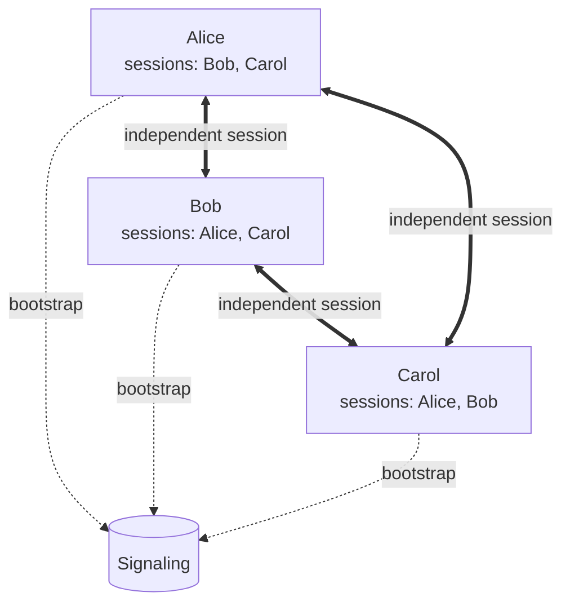

There is no group ratchet hiding inside a p2party room. There are `n-1` pairwise sessions at every endpoint, and the room URL tells the application which set of edges belongs together.

This matters because "peer-to-peer room" is easy to flatten into a diagram where the server is secretly the hub. That is not the shipped data path.

## The server introduces peers, then the mesh takes over

The current signaling service does four jobs:

1. It accepts a room capability.
2. It tells a member which peers are present.
3. It carries SDP and ICE signaling while WebRTC edges form.
4. It helps reconnect the control plane.

For a three-person room, the result is three direct or TURN-carried WebRTC associations:



A five-person room has ten pairwise edges. Each member participates in four. A logical room message is encrypted separately for every recipient edge. ML-KEM keys, ratchet counters, skipped keys, retries, and serialized state never become room-global shared mutable state.

That is more work than encrypting once under one group key. It also keeps compromise, healing, delivery, and failure boundaries pairwise. One broken edge does not force every other edge to share its ratchet state.

Commits [`9167400`](https://github.com/p2party/p2party-js/commit/9167400) and [`eeccc41`](https://github.com/p2party/p2party-js/commit/eeccc41) hardened the concurrent-join path so roster updates merge and every expected edge completes. Multi-peer behavior is not a roadmap label. It is the room topology.

## A DataChannel opening acknowledges the wrong layer

`RTCDataChannel.onopen` means DTLS and SCTP are ready to carry application bytes. It does not mean the peer has:

- verified the Ed25519 identity anchor;
- verified the cross-signed X25519 identity;
- matched the exact ML-KEM suite;
- proved the room PIN through CPace;
- bound the expected DTLS fingerprints and room policy;
- derived the same root;
- or verified p2party's final confirmation MAC.

Protocol-v3 begins its application handshake after the transport opens. Treating `open` as cryptographic acknowledgement would erase the layer we built to defend against a malicious signaling view.

The same distinction exists after a message send. Browser JavaScript returning from `dataChannel.send()` says the bytes entered a local SCTP buffer. A p2party receipt says the peer accepted a particular authenticated cell. A completed message says reassembly and durable state reached the application boundary. Those are three different events.

No finite chain of acknowledgements creates common knowledge on a lossy network. The final valid FINISH can always be dropped after the responder sends it. Protocol-v3 makes the direction explicit: the initiator establishes only after verifying FINISH, while responder completion proves it verified the initiator but cannot prove the last packet arrived.

That residual is denial of service and state coordination, not secret disclosure.

## One physical channel per logical message is a deliberate API

p2party has opened a separate DataChannel for each logical message since [`d59517b`](https://github.com/p2party/p2party-js/commit/d59517b). The model survived the rewrite because it gives clean ownership:

```text
logical message
  -> one transfer identity
  -> one channel lifecycle
  -> one buffer budget
  -> one progress stream
  -> one cancel handle
  -> one retry/reconcile boundary
  -> one teardown
```

That is why cancelling a file can leave the authenticated peer connection alive. It is also why a failed connection and a user cancellation must not be confused: the former can enter resume, while the latter should retire the transfer and its key material.

The cost is observable channel churn. In immediate mode, a new DCEP OPEN and later stream reset correlate with user activity. A future cover room must open neutral lanes on a room schedule, not on demand, and keep a cancelled lane alive until its declared close boundary. The user interface may cancel instantly. The observable schedule cannot.

## The crypto no longer needs Redux, IndexedDB, or WebRTC

The original handshake lived inside a browser handler that also read Redux state and wrote database records. That made the cryptography look browser-only even though the core operation was just an ordered byte exchange.

Commit [`743f19b`](https://github.com/p2party/p2party-js/commit/743f19b) split a store-free handshake core from the browser orchestration. Commit [`5caa1c3`](https://github.com/p2party/p2party-js/commit/5caa1c3) turned that core into the public `p2party/session` API.

`createSession()` needs:

- a role, initiator or responder;
- long-term identity material;
- the expected peer Ed25519 public key;
- channel-binding bytes supplied by the carrier;
- an ordered `send(bytes)` and `recv()` transport;
- an exact room/session policy;
- and the pinned WASM crypto module.

It does not import Redux, IndexedDB, OPFS, WebRTC, `window`, or `localStorage`.

After the handshake, the API is intentionally small:

```ts
const encrypted = await session.encrypt(plaintext);
const recovered = await peerSession.decrypt(encrypted);

const snapshot = await session.serialize();
const restored = await restoreSession(snapshot, { wasmBinary });

await session.destroy();
```

The snapshot contains plaintext ratchet secrets. A non-browser application must encrypt it at rest and add rollback protection before storage. The browser-integrated package already has a separate IndexedDB/WebCrypto persistence boundary. The standalone API does not pretend your database policy is universal.

Also, `identity.x25519SecretKey` is the X25519 identity secret. It is not the Ed25519 signing secret. The distinction is load-bearing, not naming trivia.

## Run it without a browser

The repository includes a complete two-peer in-memory transport. It creates both identities, runs the authenticated handshake concurrently, sends simultaneous first messages in both directions, serializes one ratchet, restores it, and continues the conversation.

```sh
git clone --recurse-submodules https://github.com/p2party/p2party-js.git
cd p2party-js
npm ci
bun run examples/standalone-e2ee.ts
```

The final line reports that public `createSession()` E2EE and snapshot restore
were verified without a browser.

Read the runnable source in [`examples/standalone-e2ee.ts`](https://github.com/p2party/p2party-js/blob/master/examples/standalone-e2ee.ts) and the [session API guide](https://github.com/p2party/p2party-js/blob/master/docs/session-api.md).

This is the path for a CLI, Node or Bun service, native shell, test harness, QUIC carrier, or a future private BitTorrent neighbor connection. The carrier supplies ordered bytes and a real channel binding. The cryptographic state machine does not care whether those bytes came from an RTCDataChannel.

## A readable invite is still a random capability

Protocol-v3 room invites use one 256-bit random capability. Commit [`8e8b823`](https://github.com/p2party/p2party-js/commit/8e8b823) added two encodings:

- a 43-character unpadded base64url form for links and QR codes;
- a checksum-protected 24-word form for speaking or typing.

The word form does not turn a room into a human-chosen password. It encodes the same full random capability plus a domain-separated checksum. Four cute words would be guessable. Twenty-four words preserve the entropy.

The canonical link keeps the capability after the fragment marker:

```text
https://p2party.com/r#v1.<capability>
```

Browsers do not send URL fragments in ordinary HTTP requests, which keeps the capability out of normal reverse-proxy and analytics request logs. That is useful hygiene.

It is not server-blind rendezvous. The current client still uses the decoded room capability while talking to the signaling service, which can group room members and observe stable peer identities, timing, and network metadata. Changing the alphabet does not change that control plane.

## Try both surfaces

Use [p2party.com](https://p2party.com) to create a room, share the fragment invite, and add more than one peer. Use [`p2party/session`](https://github.com/p2party/p2party-js/blob/master/docs/session-api.md) when you want the same handshake and ratchet under your own transport.

The next chapter opens that handshake and names every component. It also explains why calling it X3DH, X-Wing, or "more secure than PQXDH" would each be wrong in a different way.
