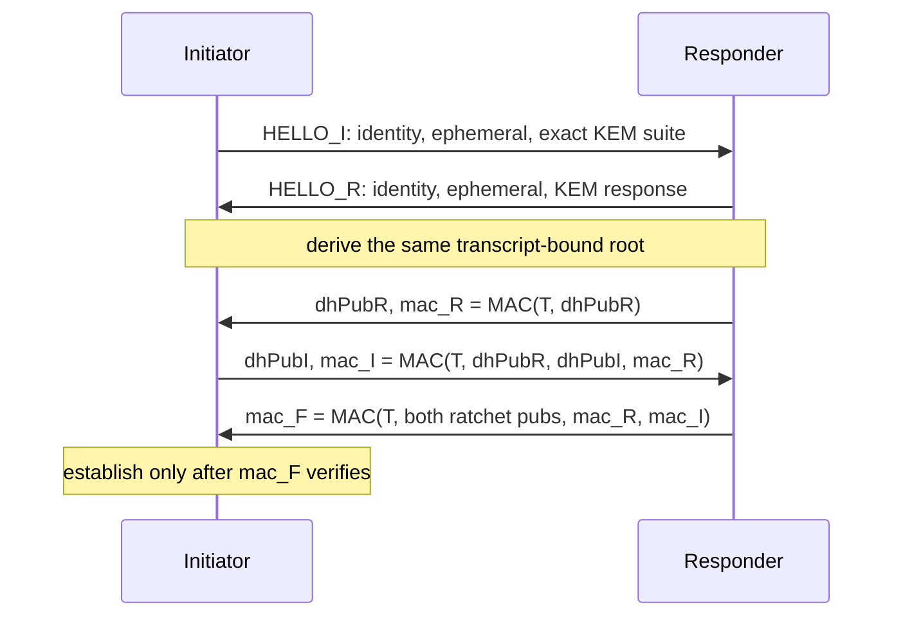

Protocol names are not security properties. Calling a construction "PQXDH-like" does not import PQXDH's proof, and using X25519 beside ML-KEM does not make a handshake X-Wing.

p2party protocol-v3 is an engineered live-edge handshake built from standard components. Its architecture fits an online WebRTC room. Its exact composition still needs the kind of formal analysis that PQXDH already has.

Both sentences are important.

## One room selects one exact profile

The room creator fixes the authentication policy and one ML-KEM parameter set before any peer handshake:

- `ML-KEM-512`, NIST category 1;
- `ML-KEM-768`, category 3 and the default;
- `ML-KEM-1024`, category 5.

Peers do not exchange preference lists. They do not infer a suite from an attacker-controlled message length. They do not retry with a weaker choice. They do not fall back to classical-only DH.

The expected HELLO shape, suite identifier, transcript, root derivation, serialized state provenance, and confirmation proofs all bind the same selection. A mismatch aborts.

This is selection, not negotiation.

Choosing ML-KEM-1024 also does not make the whole room "category 5." Ed25519 and X25519 remain classical identity and authentication components. Parameter labels do not upgrade the weakest authentication assumption by osmosis.

## The identity anchor and DH identity are separate

Each p2party identity has two classical key roles:

- Ed25519 is the long-term signing and identity anchor.
- A separately generated X25519 identity key participates in DH.

The Ed25519 key signs a domain-separated statement containing the X25519 public key. That cross-signature travels inside the peer channel and is verified before any DH secret is accepted.

Every room, PIN or no PIN, then runs an online three-DH exchange:

```text
DH(IK_a, EK_b)
||
DH(EK_a, IK_b)
||
DH(EK_a, EK_b)
```

Here `IK` is the dedicated X25519 identity key and `EK` is a fresh ephemeral X25519 key.

Some source files retain the historical name `x3dh.ts`. The live protocol is not Signal X3DH. Signal's construction supports asynchronous initiation through server-hosted prekeys. p2party has both peers online on an already-open WebRTC edge and proves possession interactively. Calling both "three DH calculations" does not erase the protocol topology.

## ML-KEM protects the recorded bootstrap

Every handshake also contributes one exact ML-KEM shared secret. The fixed-order input to the root derivation is:

```text
no PIN:  interactive3DH || ML-KEM
PIN:     CPace-ISK || interactive3DH || ML-KEM
```

The inputs pass through mode-specific and parameter-set-specific HKDF-SHA512 domains. The complete transcript is key-confirmed.

Why hybrid?

Not backward compatibility. The v3 wire is deliberately incompatible with older protocols.

The reason is assumption diversity. The classical 3DH leg avoids depending only on a newer lattice assumption. ML-KEM gives the recorded bootstrap a post-quantum confidentiality component if future quantum computers defeat X25519. If either part is implemented or analyzed incorrectly, the other may still matter.

That last sentence is an engineering goal, not a theorem about this exact combiner. RFC 9794 is explicit that hybrid protocol properties depend on the composition. We have fixed ordering, domain separation, and transcript confirmation. We do not yet have a computational robust-combiner proof for the complete interactive handshake.

Commit [`b5c0334`](https://github.com/p2party/p2party-js/commit/b5c0334) landed the pinned ML-KEM-768 WASM backend. Commit [`6e13d81`](https://github.com/p2party/p2party-js/commit/6e13d81) added exact 512 and 1024 profiles and the current confirmation chain.

## PIN rooms add CPace instead of replacing identity

A PIN-enabled room runs CPace over Ristretto255 using the room PIN. CPace prevents passive transcript collection from becoming an offline PIN dictionary.

The PIN leg is additive:

```text
CPace-ISK + interactive 3DH + ML-KEM
```

It does not replace possession of the cross-signed X25519 identity, and it does not replace ML-KEM.

The CPace channel input binds the ordered peer identities, both DTLS certificate fingerprints, the exact suite tag, and the channel identifier. Distinct root and confirmation domains bind the authentication mode and protocol version. A fresh initiator-chosen session identifier feeds the CPace generator and transcript. The application then rechecks the live DTLS certificate fingerprints through WebRTC stats and fails closed if either value is absent or different. A future cover policy needs its own canonical authenticated descriptor before it can join this boundary.

The human PIN is the server-unknown MITM anchor. Fingerprint and policy binding are additional tripwires. In a no-PIN room, a malicious signaling service that substitutes both identity views can still mediate both sides. That remains an explicit limitation.

## Three confirmations close the asymmetric hole

The old two-confirmation design let one endpoint complete while the other rejected if an attacker modified either confirmation.

The current flow chains three proofs:



A changed `mac_R` poisons the initiator proof. A changed `mac_I` prevents the responder from producing a valid finish. A changed `mac_F` is rejected by the initiator.

There is still a last-packet boundary. The responder can send a valid finish and complete locally while the network drops that finish before the initiator receives it. Adding one more acknowledgement moves the boundary one packet later. It does not create common knowledge on a lossy network.

The property we claim is directional and testable:

```text
initiator accepts
  => initiator verified responder proof
  => responder sent a finish bound to initiator proof
```

An open DataChannel cannot replace this. It was established before p2party verified the identity, PIN, KEM transcript, or root.

## Why this is not X-Wing

X-Wing combines X25519 and ML-KEM-768 as a non-interactive KEM. It is relevant combiner and size prior art. It is not the name of any protocol that happens to contain those algorithms.

p2party additionally has:

- an online three-DH possession proof;
- persistent Ed25519 and dedicated X25519 identities;
- optional CPace;
- WebRTC certificate binding;
- room policy and suite binding;
- role-dependent transcript messages;
- and a three-step application confirmation.

As recorded in the current related-work pass, X-Wing draft 10 is also an active Internet-Draft rather than a final RFC. We may adopt a standardized combiner in a future redesign. We should not borrow its name or assurance today.

## Why PQXDH has stronger assurance today

PQXDH solves a different deployment problem. An offline recipient publishes classical and post-quantum prekeys. A sender can establish a session asynchronously through the server.

p2party assumes both peers are online and already have a live WebRTC edge. That removes prekey depletion, replay, and replacement machinery, and makes an interactive PIN exchange possible. It is a legitimate architecture specialization.

It is not stronger cryptography by default.

PQXDH has ProVerif and CryptoVerif analyses under their stated models. The aggregate work covers authentication, secrecy, forward secrecy, harvest-now-decrypt-later resistance, KCI, and session independence, with important differences between the symbolic and computational results. Those proofs do not automatically cover Signal's whole deployed ecosystem or its Double Ratchet, but they are still substantially more assurance than an unproved application-specific combiner.

The p2party repository now contains a formal model scaffold at [`64dea1e`](https://github.com/p2party/p2party-js/commit/64dea1e). A scaffold that preprocesses is not a proof. The next useful steps are:

- ProVerif for pairwise no-PIN root secrecy, contextual agreement, KCI, forward secrecy, HNDL, downgrade, UKS, and channel binding;
- Tamarin for confirmation ordering, erasure timing, ratchet state, skipped keys, and room-wide consistency;
- CryptoVerif for the exact multi-input combiner rather than an idealized replacement.

The [formal-analysis README](https://github.com/p2party/p2party-js/blob/master/formal/proverif/README.md) and [related-work memo](https://github.com/p2party/p2party-js/blob/master/docs/paper-prior-art-and-related-work.md) keep that boundary visible.

## What shipped, in one sentence

Protocol-v3 establishes every live peer edge with a room-selected interactive-3DH and ML-KEM profile, optionally adds CPace for PIN authentication, chains three transcript confirmations, then seeds one pairwise Double Ratchet.

The next and final chapter asks what happens after bootstrap. That is where the hardest promise lives, and where the word "free" becomes dangerous.

## References

This post argues by comparison, so here is what it is comparing against. The
full citation set (142 entries with venue confirmations) is in
[docs/references.md](https://github.com/p2party/p2party-js/blob/master/docs/references.md).

- E. Kret, R. Schmidt. _The PQXDH Key Agreement Protocol._ Signal, 2023.
  [signal.org/docs/specifications/pqxdh](https://signal.org/docs/specifications/pqxdh/)
- K. Bhargavan, C. Jacomme, F. Kiefer, R. Schmidt. _Formal Verification of the
  PQXDH Post-Quantum Key Agreement Protocol._ USENIX Security 2024.
  [usenix.org](https://www.usenix.org/system/files/usenixsecurity24-bhargavan.pdf). the analysis p2party's handshake has **not** had.
- M. Barbosa et al. _X-Wing: The Hybrid KEM You've Been Looking For._ IACR
  Communications in Cryptology, 2024. [eprint 2024/039](https://eprint.iacr.org/2024/039)
- NIST. _FIPS 203: Module-Lattice-Based Key-Encapsulation Mechanism Standard._ 2024. [csrc.nist.gov](https://csrc.nist.gov/pubs/fips/203/final)
- M. Abdalla, B. Haase, J. Hesse. _Security Analysis of CPace._ ASIACRYPT 2021.
  [eprint 2021/114](https://eprint.iacr.org/2021/114)
- F. Driscoll, M. Parsons, B. Hale. _RFC 9794: Terminology for Post-Quantum
  Traditional Hybrid Schemes._ IETF, 2025.
  [rfc-editor.org](https://www.rfc-editor.org/rfc/rfc9794.html). why
  "hybrid" alone says nothing about authentication.
