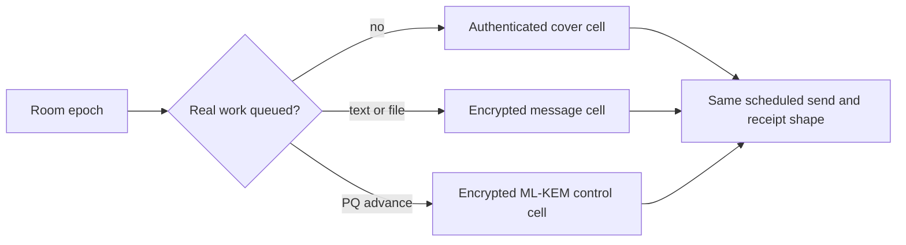

> **September 9, 2026:** This article records the earlier protocol work. The
> [current release and research update](/blog/after-the-desync-fixes) covers the
> completed desync work, runnable blind-rendezvous experiments, and the remaining
> privacy and efficiency questions.

An ML-KEM ciphertext can fit inside one p2party cell. That does not make post-quantum healing free.

The defensible claim is narrower: if a cover-enabled room was going to transmit a fixed cell at that time anyway, a ratchet advance can replace padding without adding another observer-visible application cell. The marginal scheduled frame count can be zero. CPU, battery, TURN egress, useful capacity, mesh scaling, and the schedule itself still cost real resources.

This distinction is the line between a paper question and a slogan.

## The promise was an ongoing ratchet, not a fancy first handshake

The number one commitment for this cycle was to land the Double Ratchet in p2party. The bootstrap matters, but post-compromise security comes from state that keeps moving after session establishment.

Commit [`749e3d2`](https://github.com/p2party/p2party-js/commit/749e3d2) introduced the pairwise Double Ratchet. Commit [`293ce4c`](https://github.com/p2party/p2party-js/commit/293ce4c) connected one ratchet step per logical message to per-chunk AEAD. Every message gets a message key. Every chunk under that message key gets a fresh random nonce.

That granularity matches the transport:

- Chunks can arrive out of order.
- Decoys can arrive before or after the real frame.
- A transfer may reconnect and reconcile.
- One logical message may occupy several cells.
- A different logical message must never reuse its message key.

The receiver derives on a clone, authenticates the cell, persists the successor, and only then adopts it. Skipped keys are bounded. Retired secrets are wiped. Commit [`135b0fb`](https://github.com/p2party/p2party-js/commit/135b0fb) fixed a final transport edge where a real cell could complete the message before late valid cover cells arrived, causing the receive key to be retired too early.

The browser integration wraps ratchet secrets under a non-extractable WebCrypto key before IndexedDB storage. The store-free API exposes serialization but makes the caller own encryption-at-rest and rollback defense.

That is the shipped cryptographic spine.

## The sparse post-quantum healing core existed before the wire path did

The bootstrap already includes ML-KEM. Bootstrap PQ protection is not the same as post-quantum healing after compromise.

Commit [`a426490`](https://github.com/p2party/p2party-js/commit/a426490) implements an internal per-edge sparse-healing state machine. It has:

- exact ML-KEM-512, 768, or 1024 suite binding;
- canonical full-width OFFER and ADVANCE records;
- edge identifiers, epochs, and counters;
- alternating turns;
- full-record KDF transcripts;
- prepared, committed, and acknowledged phases;
- replay, fork, and gap rejection;
- traffic gating during transitions;
- and secret wiping.

Commit [`f044286`](https://github.com/p2party/p2party-js/commit/f044286) hardened the acknowledgement boundary.

This is implemented code, not a paper sketch.

When this post was written the live path still needed canonical authenticated ACK encoding, crash-safe encrypted checkpoint and restore, byte-exact sealed-record retransmission, a separate classical/PQ message-key combiner, WebRTC control routing, and cover-scheduler integration, and production rejected nonzero PQ epochs until those pieces landed.

> **Update, 0.13.0 (protocol v4).** All six landed. Sparse-PQ healing runs on the mesh path: `prepareHealing` / `acceptControlFrame` / `pendingControl` are wired through `pqHealingOrchestrator`, state is persisted before any frame is dispatched, and application traffic is blocked while an epoch is in flight. `messageChunkCrypto` now resolves a PQ context for a nonzero epoch rather than rejecting it. Room-wide scheduled cover shipped in the same release. The epoch field widened from one byte to eight, which is part of why v4 is a wire break.
>
> We are leaving the original paragraph above rather than editing it away. A series arguing that you should not collapse status buckets does not get to quietly rewrite its own.

Our status vocabulary has three buckets:

| Status               | Property                                                                                                                                                                                                        |
| -------------------- | --------------------------------------------------------------------------------------------------------------------------------------------------------------------------------------------------------------- |
| Shipped              | Exact hybrid bootstrap, triple confirmation, pairwise Double Ratchet, fixed 65,490-byte v4 cells, message-scoped channels, resumable transfer, immediate mode, room-wide scheduled cover, sparse ML-KEM healing |
| Implemented, bounded | Timing cover, whose guarantee holds only while every edge in the room keeps emitting on the schedule, and which has been measured on loopback only                                                              |
| Research direction   | L2 server-blind rendezvous, private BitTorrent extension, machine-checked formal analysis                                                                                                                       |

Collapsing those buckets would make the roadmap look shorter and the security statement false. Moving a row up when the code lands is the other half of the same discipline.

## The room schedule buys cover with delay and bandwidth

Immediate delivery remains the default. It has the best chat UX and zero idle cover cost. It also reveals when message channels open, send, cancel, and close.

A cover-enabled room would authenticate one room-wide policy during the handshake:

- epoch origin;
- cadence;
- number of lanes;
- frames per lane;
- fixed send offsets;
- duration classes for files;
- and a future boundary for policy changes.

At every epoch, each edge sends the declared cell whether or not a user has data. A real message replaces a dummy. A sparse ML-KEM advance replaces a dummy. If the user cancels after admission, the next scheduled encrypted payload carries CANCEL and the remaining slots stay cover until the lane's planned close.



The schedule is a room property because one peer switching cadence on demand recreates the signal. A "privacy mode" button pressed only when sending sensitive text tells the observer exactly when sensitive text exists.

The configuration arithmetic is unforgiving. With one 65,490-byte application frame per direction per epoch:

| Cadence    | Mean admission wait | Pair payload per day | What it feels like                                |
| ---------- | ------------------: | -------------------: | ------------------------------------------------- |
| 10 seconds |           5 seconds |       about 1.132 GB | Foreground high-cover chat, severe channel churn  |
| 60 seconds |          30 seconds |       about 188.6 MB | Lower-data asynchronous room, poor live-chat feel |
| 5 minutes  |         2.5 minutes |        about 37.7 MB | Background dropbox or slow control cover          |

These are derived application-byte figures, not measured network costs. They exclude receipts, DCEP, SCTP, DTLS, TURN, IP overhead, loss, and retransmission. Costs scale with lane count, frames per lane, and the number of mesh edges.

At five members, the full mesh has ten edges. A 10-second, one-cell-per-direction schedule therefore moves about 11.32 GB of application payload across the room per day before protocol overhead. Privacy modes need a bill, not a halo.

## Large files force a visible policy choice

One scheduled cell every 10 seconds is not a bulk transfer protocol. Even before network overhead, the useful payload budget makes a GiB-scale file take many hours from one source.

A room has three honest options:

1. Use the base lane. This best hides whether a file exists and is intentionally slow.
2. Predeclare bulk lanes and duration buckets. The observer learns the class and bucket but not exact size, progress, completion, or cancellation inside it.
3. Send bulk immediately at available WebRTC speed. Content stays encrypted and cancellation stays local, but bulk activity and approximate volume are visible.

There is no construction that simultaneously gives arbitrary file speed, negligible dummy bandwidth, and hides whether a large transfer exists. Fast hidden bulk requires demand-independent dummy bulk capacity.

The per-message DataChannel still earns its keep. Text and file transfers retain independent progress, cancellation, backpressure, retry, and teardown. In cover mode, the physical lifecycle follows the room timetable instead of the user's click.

## The wider field killed the easy novelty claim

The first prior-art pass found the right secure-messaging neighborhood but overreached. It treated "put sparse PQ material into a fixed cover slot" as unpreempted.

The broader pass found the missing neighbors:

- Signal's Triple Ratchet and SPQR already amortize ML-KEM material across messages. SPQR uses 32-byte chunks, not the often-repeated secondary-source figure of 42 bytes, and its generic fragmentation is described as erasure coding rather than specifically Reed-Solomon.
- Apple PQ3 already deploys ongoing hybrid post-quantum ratcheting.
- Zerion 3.0 publicly documented a constant-rate messenger with 4,096-byte real-or-cover frames and dense per-frame ML-KEM.
- Post Quantum Sphinx and Outfox put post-quantum KEM material into metadata-hiding packet formats.
- OKE/Kemeleon and Hybrid OKE address the stronger problem of exposed KEM encodings that look distinguishable from random.
- PQXDH has a formal analysis baseline the p2party handshake does not yet match.

So we do not claim the first PQ ratchet, the first fixed packet carrying a KEM, a new combiner, or a primitive discovery.

The open systems question is whether p2party occupies a useful measured point:

```text
browser WebRTC full mesh
+ sparse standard ML-KEM healing
+ optional authenticated room schedule
+ per-message channel UX
+ no permanent per-frame KEM tax
```

That is paper-worthy only if packet captures, classifiers, latency, CPU, battery, TURN cost, channel churn, and mesh scaling support it. Until then it is a candidate result.

The full criticism of the original survey and the corrected prior art are recorded in [`paper-prior-art-and-related-work.md`](https://github.com/p2party/p2party-js/blob/master/docs/paper-prior-art-and-related-work.md). We keep the criticism in the source tree because forgetting why a headline was retracted is how it sneaks back into an abstract.

## Blind meeting points are the missing control plane

Fixed cells on a WebRTC edge do not hide who the signaling service placed in the room. Today the service sees the room capability, stable peer identifiers, roster requests, and every SDP/ICE handoff.

An opaque hash or OPRF output is only L1. It may hide the original room token while still giving the server one equality handle shared by every member.

The L2 research target uses short-lived private writes and reads across two or more independently operated replicas:

- DPF or Riposte-style private point writes for a dynamic presence board;
- batched information-theoretic PIR reads;
- Talek-like directional logs after two peers discover each other;
- rotating inbox identifiers and fixed-size encrypted SDP/ICE records;
- and service-wide real-or-dummy access cadence.

This is not an empty field. DP5, Private Signaling, Signal Private Groups, Talek, and 2PPS cover private presence, notification, roster, and hidden-access logs. Myco is the 2025 two-server efficiency comparator. Peer2PIR already implements private routing, provider advertisements, and content retrieval in IPFS.

The p2party-specific question is dynamic capability admission for mutually unknown members, private multi-writer slot allocation, collision and expiry, offerer-race handling, and a deterministic handoff into exactly `n-1` authenticated WebRTC edges per member.

L2a hides the application room graph from the service. L2b also needs network unlinkability. Source IP, timing, direct peer endpoints, and a colluding TURN operator survive L2a. OHTTP, independent ingress, a mix network, or onion routing may split those views, but each adds a stated trust and latency model.

Server-blind does not mean peer-blind. A compromised room member knows the roster because participation requires connecting to it.

## Private BitTorrent is a separate experiment, not a compatibility mode

The store-free session API suggests a transport-neutral test: use the p2party handshake and ratchet as the outer session for a private swarm.

Strong mode would:

- discover peers through the L2 rendezvous rather than a public tracker, DHT, PEX, or LSD;
- authenticate before exposing a conventional BitTorrent handshake;
- carry HAVE, request, piece, cancel, choke, and bitfield records inside fixed authenticated cells;
- preserve piece verification, resume, choking, rarest-first, and a sparse neighbor graph;
- refuse downgrade to plaintext discovery or wire formats;
- and count only verified useful piece bytes for reciprocity.

Dummy traffic buys privacy. It never earns upload credit.

This is not "BitTorrent with a Double Ratchet" as a first. I2P already runs BitTorrent beside an ECIES-X25519 Double Ratchet and hybrid ML-KEM work. OneSwarm already explored capabilities, disposable addresses, private lookup, tunneled BitTorrent semantics, and incentives. Peer2PIR already put private queries into a real P2P content stack.

The possible contribution is a measured operating point for private logical swarm discovery, fixed authenticated peer-wire cells, fail-closed policy, and incentives under dummy traffic. It needs a real BEP-shaped prototype before it deserves more than a research section.

It also should not copy chat's physical channel-per-message mapping. Torrent block requests belong as logical transfer IDs multiplexed over one long-lived covered neighbor connection. Opening a new channel for every block would turn demand into stream churn and set the browser on fire.

## What we are prepared to claim

The paper candidate is an applied privacy and systems composition:

1. A private control plane assembles a dynamic browser WebRTC mesh.
2. Each edge uses the shipped exact hybrid bootstrap and Double Ratchet.
3. Sparse ML-KEM healing advances occupy already scheduled room cells.
4. Message-scoped channels preserve cancellation and transfer isolation.
5. The evaluation states what direct, TURN, timing, loss, suspension, and membership observers still learn.

None of those lines is a new primitive. Together, if implemented and measured, they may be a new and useful system.

The honest venue class is applied privacy and systems security, not a CRYPTO paper claiming a new KEM. The current related-work assessment points first toward WPES or PoPETs, with a stronger venue justified only by a hardened public deployment and serious trace evaluation.

## Try what exists and inspect what does not

Try the live browser mesh at [p2party.com](https://p2party.com). Run the transport-neutral ratchet with [`examples/standalone-e2ee.ts`](https://github.com/p2party/p2party-js/blob/master/examples/standalone-e2ee.ts). Read the [protocol-v4 security guide](https://github.com/p2party/p2party-js/blob/master/docs/protocol-v4-security.md) before treating a roadmap descriptor as a shipped guarantee.

The promise is no longer a slide: the pairwise Double Ratchet, exact ML-KEM bootstrap, triple confirmation, fixed cells, and store-free session API are code.

The remaining promise is harder and more interesting. Finish crash-safe sparse PQ healing. Put it on the real WebRTC path. Build the room schedule and blind rendezvous. Capture the packets. Attack the traces. Publish the costs even when they hurt the headline.

That is how "free" becomes a result instead of a word.

## References

The full citation set is in
[docs/references.md](https://github.com/p2party/p2party-js/blob/master/docs/references.md).
The work this post's cover-traffic argument answers to:

- A. Piotrowska, J. Hayes, T. Elahi, S. Meiser, G. Danezis. _The Loopix
  Anonymity System._ USENIX Security 2017.
  [arXiv:1703.00536](https://arxiv.org/abs/1703.00536). cover traffic as a
  Poisson schedule rather than a constant rate.
- X. Cai et al. _A Systematic Approach to Developing and Evaluating Website
  Fingerprinting Defenses (Tamaraw)._ ACM CCS 2014.
  [doi.org/10.1145/2660267.2660362](https://doi.org/10.1145/2660267.2660362). the fixed-cell, fixed-cadence family this schedule belongs to.
- T. Pulls, E. Witwer. _Maybenot: A Framework for Traffic Analysis Defenses._
  WPES @ CCS 2023. [doi.org/10.1145/3603216.3624953](https://doi.org/10.1145/3603216.3624953). how to evaluate a defence instead of asserting one.
- M. Weisenseel, C. Döpmann, F. Tschorsch. _The Last Hop Attack: Why Loop Cover
  Traffic over Fixed Cascades Threatens Anonymity._ PoPETs 2025.
  [doi.org/10.56553/popets-2025-0067](https://doi.org/10.56553/popets-2025-0067). the reason a schedule alone is not an anonymity result.
- Signal Foundation. _SPQR: Signal Protocol and Post-Quantum Ratchets._ 2025.
  [signal.org/blog/spqr](https://signal.org/blog/spqr/) ·
  [github.com/signalapp/SparsePostQuantumRatchet](https://github.com/signalapp/SparsePostQuantumRatchet). the design sparse healing is modelled on; not the same construction, and
  ours has not been independently analysed.
